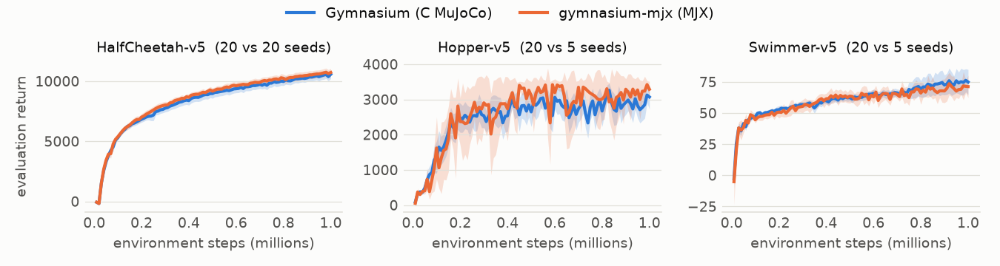

# gymnasium-mjx

Gymnasium's v5 MuJoCo tasks, unchanged, stepped in JAX by
[MJX](https://mujoco.readthedocs.io/en/stable/mjx.html). Each task loads
Gymnasium's own model file and computes Gymnasium's observation, reward,
termination, reset and time limit, so results are comparable with published
numbers on Gymnasium's MuJoCo tasks, while the tasks run under `jit` and
`vmap`, on CPU or GPU.

This is not a Farama Foundation project. The model files are Gymnasium's,
under its MIT licence (`LICENSES/Gymnasium.txt`).

## Install

```bash
pip install gymnasium-mjx                 # jax, mujoco and mujoco-mjx only
pip install "gymnasium-mjx[playground]"   # and the mujoco_playground adapter
```

Python 3.12 or newer, MuJoCo 3.7 to 3.10. The range is deliberate: the aim
is Gymnasium's tasks as its results were produced, so the package takes the
MuJoCo versions on which MJX and C MuJoCo agree. From 3.11, C MuJoCo moves
Reacher's first-joint velocity by up to 2e-8 after one step and MJX does not
follow; newer versions come in once both agree again.

## Use

```python
import jax
import jax.numpy as jnp

from gymnasium_mjx import make

task = make("Hopper-v5")  # Gymnasium's keyword arguments work too
state = task.reset(jax.random.key(0))
step = jax.jit(task.step)
for _ in range(10):
    state = step(state, jnp.zeros(task.action_size))
print(state.obs.shape, state.reward, state.done, task.episode_length)
```

`state.done` is the termination. The time limit is the caller's to apply,
as Gymnasium's `TimeLimit` wrapper does: `task.episode_length` holds
Gymnasium's (1000 steps, Reacher 50, Pusher 100). `state.metrics` holds the
reward terms of the step, under Gymnasium's names.

Many tasks at once are a `vmap`:

```python
import jax

from gymnasium_mjx import make

task = make("HalfCheetah-v5")
states = jax.vmap(task.reset)(jax.random.split(jax.random.key(0), 64))
actions = jax.numpy.zeros((64, task.action_size))
states = jax.jit(jax.vmap(task.step))(states, actions)
```

With the `playground` extra, `PlaygroundTask` presents a task as a
mujoco_playground environment, for Playground's wrappers (time limit,
auto-reset) and the libraries built on them, such as Brax's training and
Ajax:

```python
import jax

from mujoco_playground import wrapper

from gymnasium_mjx import make
from gymnasium_mjx.playground import PlaygroundTask

task = make("Reacher-v5")
env = wrapper.wrap_for_brax_training(
    PlaygroundTask(task), episode_length=task.episode_length
)
# Playground's wrappers read the batch size off raw (uint32) keys.
states = env.reset(jax.random.split(jax.random.PRNGKey(0), 8))
```

## Tasks

| Id | Episode length | Contacts |
|---|---|---|
| InvertedPendulum-v5 | 1000 | no |
| InvertedDoublePendulum-v5 | 1000 | no |
| Reacher-v5 | 50 | no |
| Swimmer-v5 | 1000 | no |
| HalfCheetah-v5 | 1000 | yes |
| Hopper-v5 | 1000 | yes |
| Walker2d-v5 | 1000 | yes |
| Pusher-v5 | 100 | yes |

Ant, Humanoid and HumanoidStandup are not here yet. They need contact forces
in the observation, and MJX has no PGS solver, which Humanoid's v5 model
uses, so those two will run with Newton's: the same task, not the same
dynamics to the last digit.

The random draws follow Gymnasium's distributions, not its generator's
stream: a reset is a sample of the same initial-state distribution, not the
same sample for the same seed.

## How it differs from Brax's MuJoCo tasks

Brax's tasks (checked in brax 0.14.2 against Gymnasium 1.2.0) are a separate
benchmark, and their results are not comparable with Gymnasium's:

- the model files are rewritten: Euler integration instead of RK4, most
  contacts disabled, Humanoid's tendons removed, Walker2d's right foot
  friction 0.9 instead of 1.9, Pusher's object density 1 instead of 0.01;
- there are no contact forces in observations or costs;
- some tasks differ outright: InvertedDoublePendulum's time step (0.02
  instead of 0.05) and velocity noise (0.01 instead of 0.1),
  HumanoidStandup's height reward, Reacher's observation and goal draw;
- the default physics is Brax's own, not MuJoCo's solver.

gymnasium-mjx keeps Gymnasium's model files byte for byte and MuJoCo's
solver (through MJX), and translates each task's code line by line.

## How it is checked

Gymnasium itself, on MuJoCo's C library, is the reference.

- **One step** (`tests/`). From 100 states Gymnasium reaches under random
  actions, one step gives Gymnasium's observation, reward and termination:
  the largest gap measured is 1.5e-10 in float64 (tolerance 1e-8), and
  1.4e-4 in float32 (tolerance 1e-3; the contact solver stops earlier).
- **Whole episodes without contacts** (`tests/`). The four contact-free
  tasks follow Gymnasium's trajectory for 40 steps within 1e-9 in float64.
  With contacts, gaps of 1e-15 grow along a trajectory, as between any two
  MuJoCo builds, so `tools/drift.py` reports how far and how fast instead.
- **Resets** (`tests/`): the initial-state distributions' bounds and moments.
- **The same policy** (`tools/same_policy.py`). An RL Zoo SAC actor runs on
  both sides for 100 episodes each; the mean returns are equivalent within
  ±2% (two one-sided tests at 5%) on HalfCheetah, Swimmer, Walker2d and
  Hopper.
- **Learning curves** (below): the same agent learns the same on both sides.

### Learning curves

SAC ([Ajax](https://github.com/YannBerthelot/Ajax)'s, same settings and
seeds) trained for 1M steps on Gymnasium and on gymnasium-mjx. Mean
evaluation return with a 95% band:

<picture>
  <source media="(prefers-color-scheme: dark)" srcset="https://raw.githubusercontent.com/YannBerthelot/gymnasium-mjx/main/docs/curves-dark.png">
  
</picture>

Final return, the mean of each seed's last 10 evaluations (the last 100k steps):

| Task | Seeds | Gymnasium | gymnasium-mjx | Difference (90% CI) |
|---|---|---|---|---|
| HalfCheetah-v5 | 20 / 20 | 10,438 | 10,624 | +1.8% (−2.0% to +5.6%) |
| Hopper-v5 | 20 / 5 | 2,897 | 3,215 | +11.0% (−1.0% to +22.9%) |
| Swimmer-v5 | 20 / 5 | 75 | 70 | −5.6% (−19.2% to +8.0%) |

Every interval contains zero. With 5 seeds on the MJX side, Hopper and
Swimmer's intervals are still wide; their 20-seed runs and Walker2d's are in
progress. The training script is Ajax's `benchmarks/mujoco_curves.py` (it
needs an agent); `tools/plot_curves.py` draws the figure and the table from
its output.

## Tools

```bash
uv run python tools/drift.py --episodes 10 --dtype float32
uv run python tools/same_policy.py --weights sac-Hopper-v3.npz --task Hopper-v5
```

Both need Gymnasium (`pip install "gymnasium[mujoco]"`). `same_policy.py`
reads an RL Zoo SAC actor (`sb3/sac-<task>-v3` on Hugging Face) saved as
plain arrays under its PyTorch parameter names.

## Development

```bash
uv sync
uv run pre-commit run --all-files
uv run pytest
```

## Licence

MIT (`LICENSE`). The model files in `src/gymnasium_mjx/assets/` are
Gymnasium's, MIT, copyright OpenAI and the Farama Foundation
(`LICENSES/Gymnasium.txt`).
