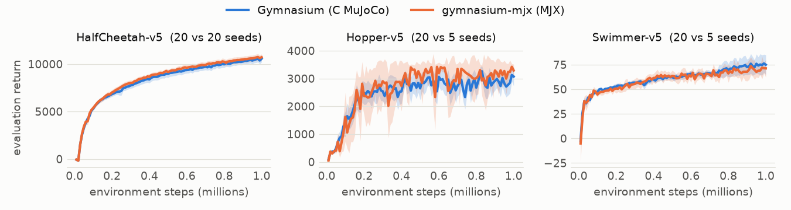

# How it is checked

Gymnasium itself, on MuJoCo's C library, is the reference.

- **One step** (`tests/`). From 100 states Gymnasium reaches under random
  actions, one step gives Gymnasium's observation, reward and termination:
  the largest gap measured is 1.5e-10 in float64 (tolerance 1e-8), and
  1.4e-4 in float32 (tolerance 1e-3; the contact solver stops earlier;
  Humanoid's forces of thousands differ by up to 9e-4 of their size).
  Humanoid and HumanoidStandup are compared with Gymnasium switched to
  Newton's solver, as they run here.
- **Contacts** (`tests/`). On random poses, each pair of geometries the
  tasks put in contact gives C MuJoCo's contacts to 1e-12.
- **Whole episodes without contacts** (`tests/`). The four contact-free
  tasks follow Gymnasium's trajectory for 40 steps within 1e-9 in float64.
  With contacts, gaps of 1e-15 grow along a trajectory, as between any two
  MuJoCo builds, so `tools/drift.py` reports how far and how fast instead.
- **Resets** (`tests/`): the first observation from Gymnasium's reset state,
  and the initial-state distributions' bounds and moments.
- **The same policy** (`tools/same_policy.py`). An RL Zoo SAC actor runs on
  both sides for 100 episodes each; the mean returns are equivalent within
  ±2% (two one-sided tests at 5%) on HalfCheetah, Swimmer, Walker2d and
  Hopper.
- **Learning curves** (below): the same agent learns the same on both sides.

## Learning curves

SAC ([Ajax](https://github.com/YannBerthelot/Ajax)'s, same settings and
seeds) trained for 1M steps on Gymnasium and on gymnasium-mjx. Mean
evaluation return with a 95% band:

<picture>
  <source media="(prefers-color-scheme: dark)" srcset="https://raw.githubusercontent.com/YannBerthelot/gymnasium-mjx/main/docs/curves-dark.png">
  
</picture>

Final return, the mean of each seed's last 10 evaluations (the last 100k steps):

| Task | Seeds | Gymnasium | gymnasium-mjx | Difference (90% CI) |
|---|---|---|---|---|
| HalfCheetah-v5 | 20 / 20 | 10,438 | 10,624 | +1.8% (−2.0% to +5.6%) |
| Hopper-v5 | 20 / 5 | 2,897 | 3,215 | +11.0% (−1.0% to +22.9%) |
| Swimmer-v5 | 20 / 5 | 75 | 70 | −5.6% (−19.2% to +8.0%) |

<!-- TODO: add Ant-v5, Humanoid-v5 and HumanoidStandup-v5 rows (10 / 10
seeds) and redraw the figure. Machines: MJX seeds and Gymnasium seeds 0-6
(HumanoidStandup 0-5) on flanders, Gymnasium seeds 7-9 and HumanoidStandup 6
on smithers, same commits and package versions; say so under the table. -->

Every interval contains zero. With 5 seeds on the MJX side, Hopper and
Swimmer's intervals are still wide; their 20-seed runs and Walker2d's are in
progress. The training script is Ajax's `benchmarks/mujoco_curves.py` (it
needs an agent); `tools/plot_curves.py` draws the figure and the table from
its output.

## Speed

Environment steps per second under uniform random actions, resetting ended
episodes, compilation excluded (`tools/speed.py`). Gymnasium runs its vector
environments on CPU; gymnasium-mjx runs a jitted, vmapped step.

MJX pays off with many environments on a GPU. With one or a few
environments on a CPU, C MuJoCo is faster. Each task compiles once per batch
size, which takes from seconds to minutes.

## Tools

```bash
uv run python tools/drift.py --episodes 10 --dtype float32
uv run python tools/same_policy.py --weights sac-Hopper-v3.npz --task Hopper-v5
uv run python tools/speed.py --task Hopper-v5 --envs 1 256 4096 --side mjx sync async
```

Both need Gymnasium (`pip install "gymnasium[mujoco]"`). `same_policy.py`
reads an RL Zoo SAC actor (`sb3/sac-<task>-v3` on Hugging Face) saved as
plain arrays under its PyTorch parameter names.
